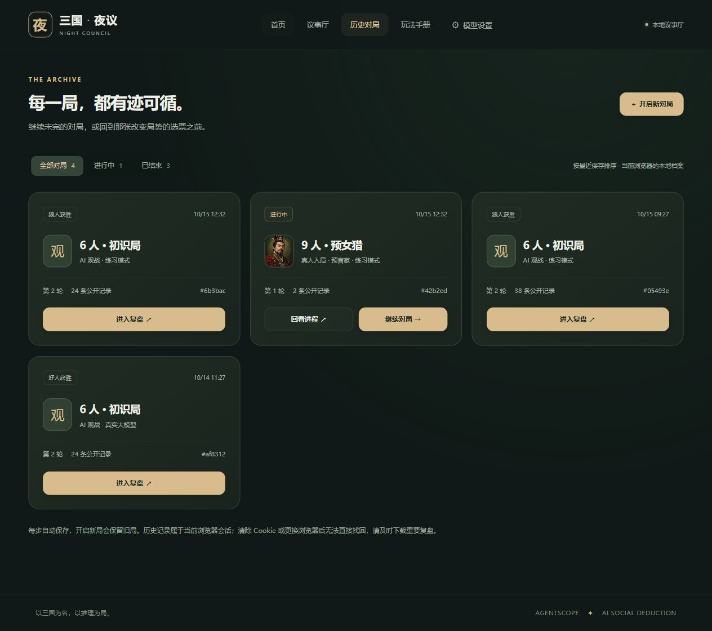
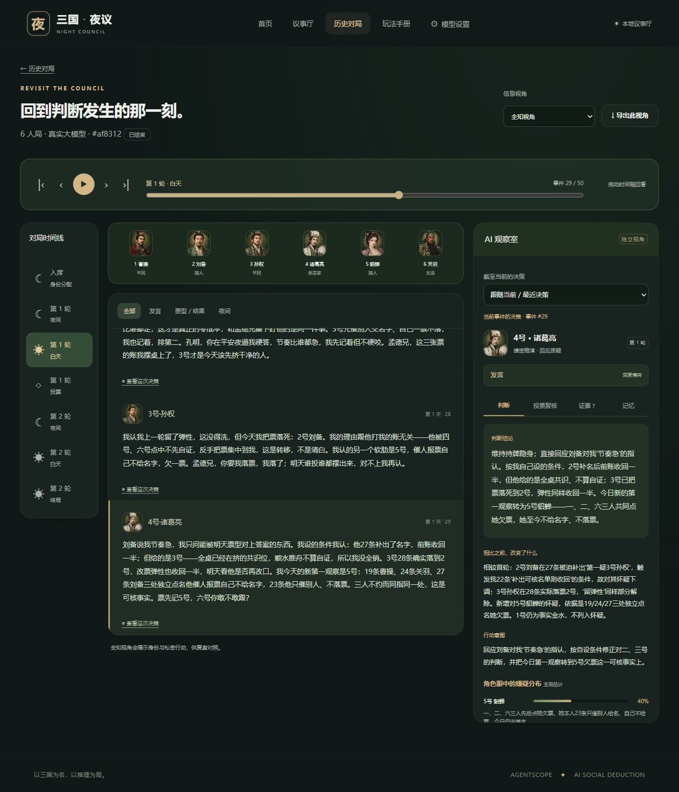
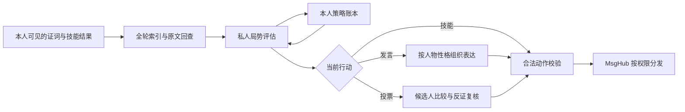

<div align="center">


**大模型驱动的三国人格狼人杀 · 你的下一位对手，可能比你更会说谎。**


[](https://github.com/XiaoyeCodes/AI-Three-Kingdoms-Kill/actions/workflows/tests.yml)

[快速开始](#快速开始) · [游戏截图](#游戏截图) · [AI 如何决策](#ai-如何决策) · [系统架构](#系统架构) · [完整使用指南](docs/USER_GUIDE.md)

</div>

---

曹操会施压，刘备会结盟，诸葛亮会追查证词，司马懿会有所保留。人物性格与狼人杀身份分别分配：坐在你旁边的“预言家”，也许正在延续昨夜编好的故事。

**三国 · 夜议**是一款本地运行的网页狼人杀游戏。你可以亲自入局，也可以以全知视角观察 AI 博弈。规则由程序裁定，角色由真实 AgentScope `DialogAgent` 承载，公开讨论、狼队密聊与个人情报通过 `MsgHub` 按权限传递。

## 游戏截图

**首页 · 各怀其心，由你识破**


**历史 · 每一局都有迹可循**



**复盘 · 回到判断发生的那一刻**



<sub>以上为实际网页截图，使用独立验收数据库。复盘截图取自此前完成的真实 DeepSeek 六人对局；旧记录没有最新投票复核字段时，页面会明确提示。九位人物插画本地加载，性格与狼人杀身份分别分配。</sub>

## 有什么可玩

| 体验 | 实现 |
| :--- | :--- |
| **亲自入局 / 全局观战** | 一名真人与 AI 对弈，或观看 6 / 9 名 AI 的整场博弈 |
| **经典角色与完整流程** | 狼人、预言家、女巫、猎人、平民；昼夜轮替、回应对质、封存投票、PK、遗言与胜负结算 |
| **各有性格的对手** | 九种表达与决策风格，支持游戏内伪装、悍跳、假查验与倒钩 |
| **跨轮记忆** | 每人独立的完整档案、全轮索引、原文检索和私人策略账本 |
| **独立投票复核** | 深度模式逐个比较候选人与弃票，检查反证、重复指控、最新辩护和改票条件 |
| **AI 观察室** | 判断 / 投票复核 / 证据 / 记忆四页，点击发言或选票关联决策；私有记录不向其他 AI 广播 |
| **自由配置模型** | 全局 → 身份 → 座位三级覆盖，可让不同角色使用不同 API key 或模型 |
| **首页与历史档案** | 继续未完对局、查看最近故事、筛选历史；新局保留旧局，随时恢复原回合 |
| **逐步复盘** | 昼夜章节、时间轴、播放与暂停、公开 / 角色 / 全知视角；按当时信息回看与导出 |

> 无密钥也能体验：选择 **练习模式**。这是明确标注的规则机器人，用来熟悉流程；真实语言博弈需配置 LLM。

## 快速开始

需要 **Python 3.12**。推荐使用 [uv](https://docs.astral.sh/uv/)；网页无需 Node 构建步骤。

```bash
git clone https://github.com/XiaoyeCodes/AI-Three-Kingdoms-Kill.git
cd AI-Three-Kingdoms-Kill
uv venv --python 3.12 .venv
uv pip install --python .venv -r requirements.lock.txt
```

**Windows**

```powershell
.venv\Scripts\python.exe run.py
```

也可直接双击根目录的 **`启动游戏.cmd`**，脚本会创建环境、安装缺少的依赖并打开网页。

**macOS / Linux**

```bash
.venv/bin/python run.py
```

打开 **[http://127.0.0.1:8765](http://127.0.0.1:8765)**，在首页点击「开启新对局」，选择席位、棋局与对手后入席。未完成的故事可以从首页或「历史对局」继续。

<details>
<summary>不使用 uv 的安装方式</summary>

```bash
python -m venv .venv
# Windows
.venv\Scripts\python.exe -m pip install -r requirements.lock.txt
# macOS / Linux
.venv/bin/python -m pip install -r requirements.lock.txt
```

请先确认 `python --version` 为 Python 3.12。运行时保持服务进程开启，按 Ctrl+C 停止。

</details>

### 连接你的模型

打开右上角 **模型设置**，填写 OpenAI 兼容接口的 `Base URL`、模型名称和 API key，测试连接后开始真实对局。优先级为 **座位配置 > 身份配置 > 全局配置**。

也支持服务端环境变量：

```powershell
$env:DEEPSEEK_API_KEY = '<your-api-key>'
$env:LLM_BASE_URL = 'https://api.deepseek.com'
$env:LLM_MODEL = 'deepseek-flash'
.venv\Scripts\python.exe run.py
```

模型需支持非流式 Chat Completions 与 JSON object 输出，建议至少 32K 上下文。实际可用模型名称以供应商账户为准。

API key 不进入游戏存档、复盘或前端响应。网页填写的密钥仅驻留服务端内存，重启后需重新配置；本地配置文件方式见[使用指南](docs/USER_GUIDE.md#模型配置与密钥)。真实对局会产生 API 费用。

## AI 如何决策



**深度博弈**是默认模式。DeepSeek 官方接口的评估请求启用原生思考，发言另用一次请求组织表达；其他兼容接口使用相同的阶段划分，但不会擅自发送 DeepSeek 专用参数。技能和投票无需额外表达请求。

投票时，每个 AI 要核对所有合法候选人及弃票，区分“独立证据”和“多人重复同一个说法”，回应目标的最新辩护，再给出最终取舍。**允许有依据的一致投票，不通过随机分票制造独立思考的假象。**

记忆和调试摘要仅属于各自玩家。观察室显示显式生成的简短结论，**不采集、保存或展示模型原始内部思维链**。普通真人局保持信息迷雾；主动开启全知调试后会明确标记本局。

深度模式更慢、用量更高。页面显示真实等待时间；阅读间隔单独设置。模型超时、额度不足或动作不合法时保留当前回合，不静默切换为练习机器人。也可以主动选择更快的单次决策模式。

## 规则一览

| | 九人 · 预女猎 | 六人 · 初识局 |
| :--- | :--- | :--- |
| 狼人 | 3 | 2 |
| 平民 | 3 | 2 |
| 神职 | 预言家、女巫、猎人 | 预言家、女巫 |

- **胜负**：狼人全部出局，好人胜；平民或神职全部出局，狼人胜。采用屠边规则。
- **夜晚**：狼人协商与刀票 → 预言家查验 → 女巫用药 → 天亮统一结算。狼人不能空刀、自刀或刀队友。
- **白天**：首轮发言 → 回应与对质 → 封存投票 → 统一公布。首次平票 PK，复投仍平票则无人出局。
- **女巫**：解药与毒药各一次，同夜只能用一种；仅首夜可自救。
- **猎人**：被刀或放逐可开枪，中毒不能开枪。无警长、无守卫。

各地区规则存在变体，本作以[完整规则合同](docs/DEVELOPMENT_PROMPT.md)和网页玩法手册为准。

## 系统架构

| 层 | 职责 | 实现 |
| :--- | :--- | :--- |
| 游戏控制 | 维护状态、行动队列、合法动作与胜负；LLM 无权改写规则 | [`ThreeKingdomsWerewolfGame`](werewolf/game.py) |
| 智能体交互 | 公开消息、狼队密聊、个人情报与封存选票的权限路由 | [`HubRouter` / AgentScope `MsgHub`](werewolf/agents.py) |
| 角色建模 | 角色身份、人物性格、模型调用和私人策略 | [`WerewolfDialogAgent(DialogAgent)`](werewolf/agents.py) |
| 记忆与策略 | 全轮索引、原文回查、评估校验、投票复核、表达检查 | [`memory.py`](werewolf/memory.py) · [`strategy.py`](werewolf/strategy.py) |
| 服务与持久化 | FastAPI、SQLite、会话隔离、并发保护、视角裁剪 | [`server.py`](werewolf/server.py) |
| 历史与复盘 | 逐局存档、只读时间投影、接收者权限、历史账本与原文检索 | [`replay.py`](werewolf/replay.py) |
| 网页 | 原生 HTML / CSS / JavaScript，响应式布局，无构建依赖 | [`web/`](web/) |

明确固定 **AgentScope 0.1.6**，以使用真实 `DialogAgent` 与 `MsgHub`。模型请求单独适配，避免旧版全局模型管理器持有多局密钥。迁移新版框架需要调整接口，不能直接升级版本号。

## 测试与已知边界

```powershell
.venv\Scripts\python.exe -m pytest -q
node --check web/app.js
node --check web/product.js
```

当前本地回归 **86 项通过**，覆盖角色技能、胜负边界、平票、40 局练习模式完整运行、20 轮记忆、消息与调试隔离、存档恢复、历史迁移、时间点权限、API 并发保护和独立投票协议。浏览器另行跑通新局至终局、历史续局、复盘回放、角色记忆检索与 JSON 导出，并检查 390px 窄屏。

此前真实六人深度对局已跑完 **2 个游戏日、29 次行动**，约 **14.5 分钟 / 345,625 tokens**，没有练习机器人兜底。这是单次观测，不代表平均费用、推理正确率或胜率。最新投票复核的真实模型回归尚未完成；结构与隔离测试通过，不等同于已证明策略效果。详情见[验收报告](docs/ACCEPTANCE.md)。

<details>
<summary>真实模型验收命令（显式运行，会产生 API 用量）</summary>

```powershell
# 连接与 JSON 输出
.venv\Scripts\python.exe scripts/live_acceptance.py
# 六人深度完整局
.venv\Scripts\python.exe scripts/deep_game_acceptance.py
# 固定矛盾证词、人物表达、真实查验与狼人伪装
.venv\Scripts\python.exe scripts/strategy_acceptance.py
```

报告保存在被 Git 忽略的 `.local/` 中，不含密钥或原始思考正文。特定历史对局重放脚本需要本机对应存档，不属于公共测试的前置条件。

</details>

当前产品面向 **本地单真人 + 多 AI**，支持独立浏览器会话；不包含远程多人房间或语音。服务默认仅监听 `127.0.0.1`。跨会话密钥与信息隔离不等于公网部署认证，公开部署需另加账户、TLS 与访问控制。

## 文档导航

| 文档 | 内容 |
| :--- | :--- |
| [产品复查与升级](docs/PRODUCT_REVIEW.md) | 首页、历史、复盘与观察室的设计和验收 |
| [人物素材与提示词](docs/AVATAR_ASSETS.md) | 九位人物的本地资源和生成提示词 |
| [使用指南](docs/USER_GUIDE.md) | 安装、配置、玩法、记忆、调试与复盘 |
| [开发提示词与规则合同](docs/DEVELOPMENT_PROMPT.md) | 产品目标、规则研究与实现里程碑 |
| [架构与实现](docs/ARCHITECTURE.md) | 消息边界、状态机、接口与扩展方式 |
| [博弈质量方案](docs/STRATEGY_UPGRADE.md) | 思考、表达、长期记忆与反跟票设计 |
| [验收报告](docs/ACCEPTANCE.md) | 自动测试、真实对局结果与验证局限 |

---

<div align="center">
<sub>以三国为名，以推理为局。<br>Built with AgentScope · FastAPI · Python</sub>
</div>
