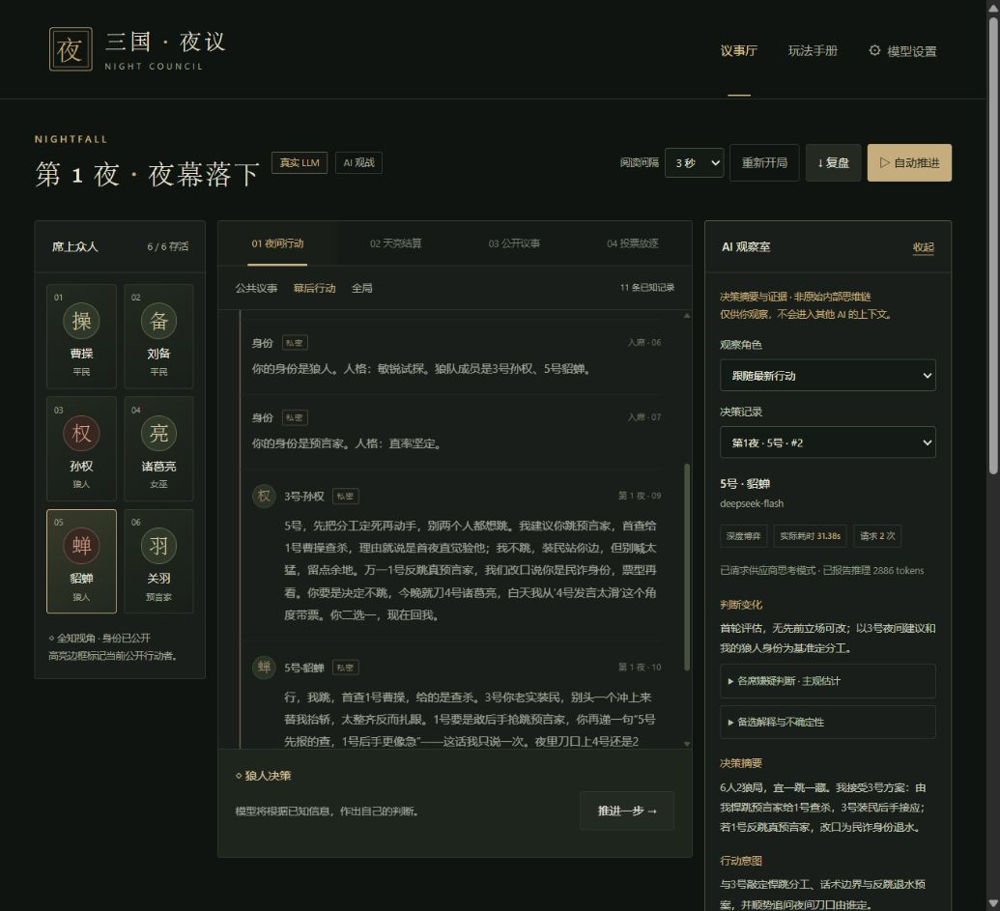

# 交付验收 · 三国夜议

验收日期：2026-10-14。运行环境：Windows、Python 3.12、AgentScope 0.1.6、FastAPI、原生 HTML/CSS/JavaScript。

## 发布前验收

- 从锁定依赖新建独立 Python 3.12 虚拟环境，91 个依赖安装成功，依赖兼容检查通过；该全新环境运行 **76 passed**，3 项第三方依赖弃用警告。
- `node --check web/app.js` 通过。实际网页九人练习模式从开局自动运行至第3天终局，浏览器错误日志为空。
- README 使用实际首页截图和已有真实模型对局截图；所有文档本地链接与待发布文件的密钥扫描通过。
- 最新投票协议的真实模型复测仍待可用服务额度；此前真实对局结果只作为历史集成验证。CI 配置涵盖 Windows 与 Linux，不调用付费 API；远端结果以 GitHub Actions 为准。

## 独立投票复核追加验收

2026-10-14追加：自动测试 **76 passed**，3项依赖弃用警告；JavaScript语法及投票复核HTML输出、文本转义、旧记录兼容检查通过。深度放逐投票和PK投票强制比较全部合法目标及弃票，并核对重复指控来源、最新辩护、最终取舍与改票条件。复核只留在本人账本与人类调试界面，不发送给其他模型。失败不写选票。

读取原局记录确认第二天5、6、7、8、9号全部投1号，属于旧单次决策流程。代码与回归测试确认封存选票隔离正常。已实现针对该局投票前历史的只读重放脚本，但首次真实调用返回HTTP 402，未生成任何新选票；不重复调用，不修改用户存档。当前只能确认实现与工程测试通过，**真实模型的反跟票效果尚未复测**。上一次深度整局与固定样例结果不证明这次投票协议的效果。

## 深度博弈升级验收

用户反馈旧版同质化、缺少独立判断后，默认配置已改为 deep：原生思考评估 + 独立人物表达，增加投票前回应轮次、实际请求遥测、独立阅读间隔及公开板子/发言进度信息。详细方案与质量边界见 [STRATEGY_UPGRADE.md](STRATEGY_UPGRADE.md)。以下基础验收数字保留为历史，升级后的测试为 **67 passed**。

- 固定矛盾局面的四人配对测试：快速/深度均 4/4 引用关键矛盾证据；深度平均15.23秒，快速4.20秒。字符相似度指标仅用于检测复读，不代表胜率。
- 真实预言家决策正确投给已查验的狼人；狼人测试保留私人伪装计划。表达阶段去除内部事件编号后，复测发言正常引用玩家及轮次，没有把日志号当座号。
- 六人真实深度整局：2个游戏日、29项行动、50次应用层模型调用、34次原生思考评估请求，包含6次回应与对质；好人获胜。总计345,625 tokens，870.83秒（约14.5分钟），未使用练习策略兜底。报告为 `.local/deep-game-acceptance.json`，完整状态和复盘分别为 `.local/deep-game-state.json`、`.local/deep-game-replay.json`。
- 整局运行期间发现的公开规则与发言顺序遗漏已通过新增上下文与回归测试补齐；该整局使用的是启动时版本。其后另外执行最新提示词的真实完整行动测试，不能把该整局报告当成每次提示词调整后的重复验证。
- 网页真实观战：显示“独立评估证据与行动 · 已等待11秒”；一条双阶段发言报告2次请求、31.38秒、2,886推理tokens，另一条报告4,350推理tokens。技能动作仅一次评估请求。侧栏可按历史行动查看判断变化、嫌疑估计、备选解释与引用。
- 正式服务已更新，既有存档保留并在更新前备份。默认深度模式已在正式网页确认。较窄桌面仍并排显示调试栏；移动视口的可视宽度与滚动宽度均375像素，无横向溢出，测试后恢复窗口尺寸。

最终代码的真实行动复测：评估27.69秒、表达2.33秒，共30.01秒、2次请求；供应商报告3,004推理tokens，评估格式重试0次。发言对照两天原话识别矛盾，并给出投票及改票条件。报告位于 `.local/strategy-final-smoke.json`。

新测试覆盖双阶段私有隔离、已评估目标执行、表达失败不提交半成品、复读重写、原生参数/预算、预算耗尽不降级、角色与座位的决策模式继承、忙时阶段信息不泄密、第二轮对质及发言顺序。

## 需求核对

| 交付要求 | 实现与证据 |
| --- | --- |
| 完善提示词及实现目标 | DEVELOPMENT_PROMPT.md 包括体验、规则合同、架构、里程碑、验收标准和研究来源；ARCHITECTURE.md 解释实现 |
| 真实 AgentScope | WerewolfDialogAgent 继承安装的 DialogAgent；HubRouter 使用真实 msghub；类型和接收者隔离测试通过 |
| 完整狼人杀 | 6/9 人、狼人、预言家、女巫、猎人、发言、封存投票、PK、遗言、技能结算、屠边胜负 |
| 可操作网页 | 真人入局、AI 观战、练习/真实模式、自动/单步、暂停、重开、模型配置、复盘导出 |
| 每个角色独立模型 | 全局、身份、座位三级覆盖；真实 DeepSeek 调用成功；密钥不写入游戏存档或响应 |
| 跨轮上下文与记忆 | 完整档案、逐人全轮索引、精选原文、主动回查、私有策略账本；20 轮长历史测试与重启恢复测试通过 |
| 欺骗与性格 | 9 个人格行为规范和身份策略；狼人装民、悍跳、虚构查验、倒钩等策略提示；真实对局生成了身份说辞和后续伪装计划 |
| 旁栏调试 | 真实模型的摘要、行动意图、证据、私有账本、记忆搜索；普通真人局保护与调试局标记 |
| 其他模型看不到调试 | 摘要不进入 Msg 或 metadata；账本只进入本人的后续模型输入；实际构造模型请求的隔离测试通过 |
| 可恢复运行 | SQLite 每步存档，刷新和恢复保持状态；启动脚本、依赖锁文件、使用文档齐全 |

## 自动验证

基础交付时 `python -m pytest -q`：**53 passed**，3 个依赖弃用警告，无失败。`node --check web/app.js`：通过。最新升级结果见上文。

覆盖关键规则边界：夜间同时结算、被刀角色仍可行动、毒与刀叠加、女巫自救和用尽解药、猎人中毒禁枪、胜负前先结算技能、票型封存、平票 PK、全弃票、屠边而非人数持平判胜。包含 6 人与 9 人共 40 局练习模式完整运行。

覆盖工程边界：非法动作不推进、模型错误暂停、JSON 纠错、跨房间隔离、重复提交/并发保护、视角过滤、会话及同源校验、API key 不回显或持久化、不同地址不继承密钥、旧存档迁移。

记忆测试构造 20 轮、每位玩家多轮长发言，确认每条证词仍有索引且完整原文可回查，早期证据不会因最近消息增多而从档案丢失。模拟模型请求验证早期原文回查、越权消息不可读、自己账本进入下次请求且不会进入其他人的请求。

## 真实模型整局

使用本机用户配置的 DeepSeek 官方接口，模型 `deepseek-flash`，9 人 AI 观战，固定种子 731。运行 `scripts/live_acceptance.py --full`，未使用练习机器人兜底。

| 指标 | 结果 |
| --- | --- |
| 结局 | 好人获胜 |
| 游戏日 | 4 |
| 行动 / 对局模型调用 | 74 / 74 |
| 整体脚本耗时 | 316.2 秒（含连接预检） |
| 对局已报告总 tokens | 507,308 |
| 调试行动记录 | 74 |
| 模型提供的非空摘要 | 73；另 1 条显示明确的缺失提示，不伪造 |
| 有策略记录的角色 | 9 |
| 各角色档案条数 | 59、19、43、41、20、48、60、59、74 |

原始报告：`.local/live-acceptance.json`。完整可恢复状态：`.local/live-game-state.json`。完整复盘：`.local/live-replay.json`。这些本地验收数据被 Git 忽略，不含 API key。连接预检另有少量 token；以上 token 为游戏内成功响应统计，不代表所有供应商账单。

该实测局未触发主动回查；其历史规模尚可放入索引及精选记录。主动回查与隔离能力另由长历史模拟模型测试验证，不把模拟验证冒充真实模型行为。单局获胜不能证明 AI 的策略强度或胜率；人格与谎言策略是模型决策约束，不保证每次表现一致。

## 浏览器验收

使用独立 QA 数据目录和端口，避免替换用户原有对局。完成以下实际交互：真人预言家开局、调试解锁提示及全知标记、自动推进停在真人行动、提交查验并显示阵营结果、按角色与关键词检索私有原文；另开真实模型观战并推进一次行动，侧栏成功显示 `deepseek-flash` 摘要、引用、身份说辞和策略账本。设置页面可选全局、身份或座位，并隐藏已配置的 API key。

桌面三栏与 390×844 移动视口检查通过，移动页面无横向溢出；刷新后对局和调试数据仍在，浏览器错误日志为空。临时视口已恢复。

正式服务 `http://127.0.0.1:8765` 健康检查成功。原有真人存档成功恢复，旧版本留下的模型错误在更新后重试成功，继续保持身份迷雾；未开启该局的全知调试。启动脚本通过 PowerShell 语法与依赖检测检查，源码及验收输出的真实密钥扫描结果为零。

- [桌面调试完整截图](screenshots/ai-debug-desktop.png)
- [桌面预览](screenshots/ai-debug-preview.png)
- [移动布局](screenshots/ai-debug-mobile.png)

## 产品边界

交付为本机可运行的单真人、多 AI 游戏，支持独立浏览器会话；不是公开多人联机服务。不包含语音、警长、守卫或账户体系。使用了具有 DialogAgent 的旧版 AgentScope，锁文件记录当前可运行依赖；已有依赖弃用警告不影响本次验收。

模型可读取完整档案的索引、精选原文与自己的笔记；并非每次请求都塞入所有历史，也无法保证模型永不误判。长历史会增加 token 用量，上下文能力较小的模型可能需要更换。调试展示显式生成的简短决策说明，不读取或展示原始内部思维链。
