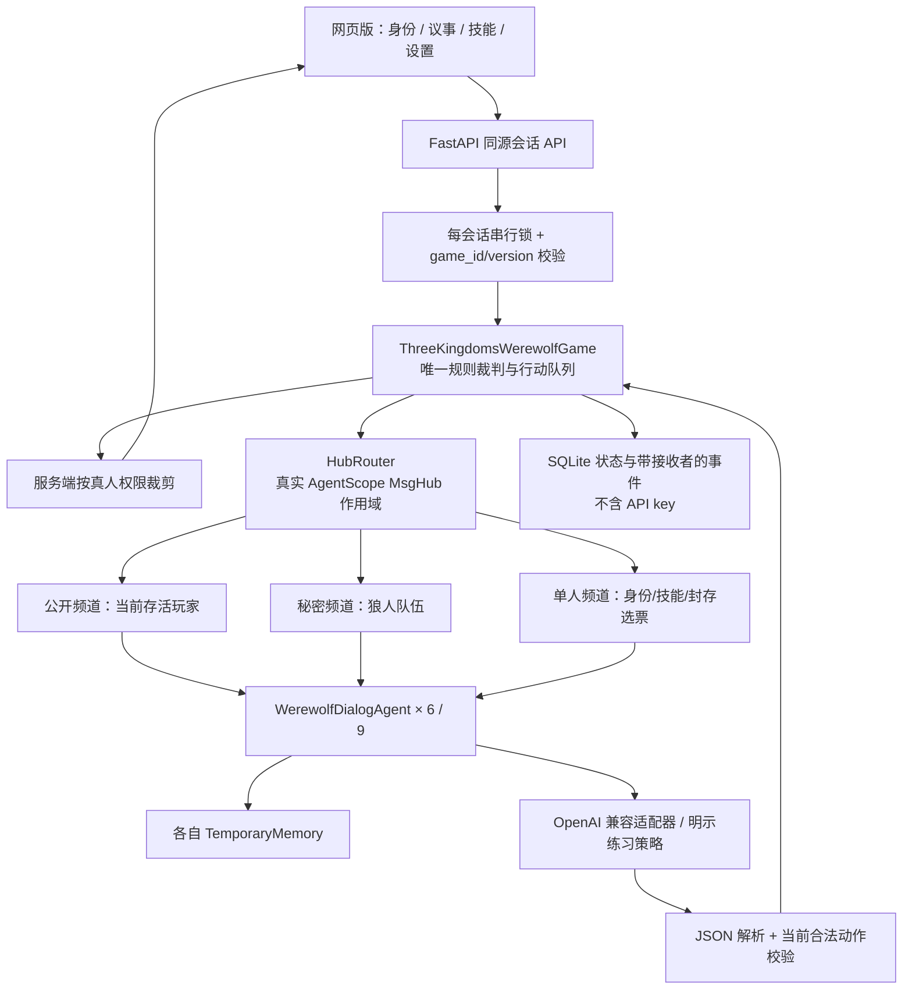

# 架构与实现过程

## 架构决策

保留用户指定的三个核心抽象。AgentScope 1.0 已移除 DialogAgent，所以明确锁定 0.1.6，不创建同名假类冒充框架。`WerewolfDialogAgent(DialogAgent)` 覆盖 `reply`，接入有界的 JSON 输出与校验，并沿用真实 `AgentBase.__call__`、`observe`、TemporaryMemory 和 MsgHub 的接收者路由。

模型配置不用 AgentScope 旧版全局 ModelManager，避免跨会话全局密钥注册与默认日志落盘。该部分由独立 OpenAI SDK 适配器实现。消息基础设施仍完全使用 AgentScope，`HubRouter` 仅管理其作用域，不是另造消息总线。



## 游戏控制

队列既包含玩家行动，也包含法官转换步骤。`_settle` 只执行法官步骤，直到遇到下一个玩家行动。`advance` 每次最多执行一项玩家行动，因此 UI 可逐步观看、在真人回合停下、恢复失败请求。

```text
night_start
  → 每位狼人协商 → 每位狼人封存刀票 → wolves_resolve
  → 预言家查验 → 女巫用药 → dawn（统一死亡）
  → 首夜遗言 / 合法猎人技能 → check_win
  → day_start → 轮换起始座次、依次公开发言 → 全员回应与对质
  → vote_start → 各自封存选票 → tally
      → 唯一最高票：放逐 → 遗言 / 猎人 → check_win → night_start
      → 首次平票：pk_talk → 非平票玩家 pk_vote → tally
      → 再平票 / 全弃票：night_start
```

毒药优先于刀的死亡原因，救治仅取消刀伤。所有夜间任务都在 dawn 前完成。胜负在死亡技能结束后检查，避免猎人最后一枪被过早判胜吞掉。最多 20 轮阻止无限平票。

## 信息边界

每位智能体只拥有自己的系统角色和经 MsgHub 收到的记忆。向模型提供的 context 是该玩家的合法行动、公开存活座位、自己可见的队友/查验/药品信息，不传入游戏对象或完整角色表。

所有公开信息、私密法官结果及角色回复经真正的 MsgHub 分发。作用域不嵌套，每次退出会清空 audience。选票在单人作用域提交，最后由法官统一广播票型。模型公开回复只发送 speech，技能的 JSON 动作只在单人频道；内部思考内容不保存、不展示。

真人 `view()` 在服务端过滤身份、事件、当前行动者与技能数据。死亡原因不随普通死亡公告发出。普通真人局中，出局后仍不能看到全局；终局、开局选定的 AI 观战或明确开启的调试局可见全部。导出复盘直接使用同一视角函数，不能成为绕过隐藏信息的通道。

## API 与运行模型

| 路径 | 用途 |
| --- | --- |
| GET /api/state | 当前会话的裁剪视角；忙时只返回 busy |
| POST /api/games | 创建 6 / 9 人对局 |
| POST /api/step | 推进一名 AI 或提交真人动作，携带 game_id/version |
| GET /api/settings | 仅返回模型元信息和是否配置密钥 |
| POST /api/settings | 全局、角色、座位覆盖；保留或清除密钥 |
| POST /api/test-model | 显式调用模型验证 JSON 连接 |
| POST /api/practice | 明确切换当前局至练习模式 |
| GET /api/replay | 下载当前视角或终局完整 JSON 复盘 |
| POST /api/debug | 真人主动开启全知调试，永久标记本局；携带 game_id/version |
| GET /api/memory/{seat} | 仅观战、终局、调试局可检索指定 AI 自己的原文档案 |

同步请求由 FastAPI 的线程池执行，每局拥有独立 Lock。正在进行模型调用时重复请求返回 409；回合结束后的旧 version 也返回 409。不同会话的智能体和密钥互不共享。API 只允许本机 host，同源写请求验证 Origin 和自定义请求头，Cookie 设置 HttpOnly / SameSite=Strict。

每步保存完整状态及事件接收者列表到 SQLite。重启时重新实例化智能体，再通过 MsgHub 按原接收者恢复记忆。API key 和 OpenAI 客户端不序列化；配置文件仅在启动时读取。持久化按操作系统文件权限保护，不宣称数据库加密。当前房间为每个浏览器会话保留一局，无账户和历史对局列表。

## 实施目标与依赖

| 阶段 | 目标 | 实现与验收依据 |
| --- | --- | --- |
| M1 | 规则研究与完善提示词 | DEVELOPMENT_PROMPT.md，规则页、官方来源链接 |
| M2 | 可测试规则内核 | game.py，夜间同步结算 / 猎人 / 平票 / 屠边测试 |
| M3 | 真实 AgentScope 和模型集成 | agents.py，MsgHub 接收者断言、真实 DeepSeek 调用 |
| M4 | 可玩的网页 | 真人技能与发言、AI 观战、设置、双视角记录、响应式页面 |
| M5 | 完整交付 | 数据恢复、并发保护、完整模拟与真实对局、浏览器验收、启动文档 |

实现优先做规则和信息隔离，再接模型及 UI，最后验证完整链路。实际测试结论与限制记录在 ACCEPTANCE.md。

## 扩展接口

### 跨轮记忆与调试隔离（2026-10-14）

`EvidenceMemory` 只能接收某个智能体的 TemporaryMemory，不接受全局事件表。它从带事件编号、轮次、作者的消息构建按发言者分组的全轮次索引，原文独立完整保留。每次模型输入组合索引、预算内精选原文和自己的 notebook；`recall` 最多两轮，每轮最多八条，只能查询自己的 `by_id`，不存在或越权编号统一不给结果。

索引使用原文摘录，不调用另一个模型生成未经核验的“事实”。预言家查验等官方消息与普通证词由 kind 区分；私有 notebook 标注推测或编造。长局缩短摘录以控制上下文，但不删除索引条目或归档原文。事实、证词与策略不会因为同一个 AI 表达得很坚定就合并为真实身份。

LLM 的响应解析后分成两条数据路径。合法的 `action/target/speech` 组成 Msg，按 MsgHub 当前权限广播；`decision_summary/notebook` 经长度、类型和证据权限校验，只存入该 agent 私有状态与游戏 debug_traces。其内容不成为 Msg 内容或 metadata。完整 snapshot 额外持久化 agent_notebooks，旧存档缺字段时兼容为空。

调试查看走独立 `/api/debug` 与 `/api/memory/{seat}`，普通真人局由服务端拒绝查看其他 AI 私有档案。开启调试只改变人类可见的视角和 debug_mode 标记，不改变任何 AI 的 context 或 MsgHub 接收者。调试摘要是显式生成的结论说明，不采集供应商原始推理字段。真人自愿开启后不再宣称本局保持正常信息迷雾。

### 后续玩法扩展

添加新角色应扩展规则合同、合法行动与夜间队列，并同步测试，不依靠更长的提示词临时实现。升级 AgentScope 1.x / 2.x 时应迁移为异步 AgentBase/ReActAgent 与新版 MsgHub，当前同步版不能仅替换 import。多人在线需要独立房间成员权限和座位归属，不能复用本地单真人会话模型。

## 深度博弈升级

`ModelConfig.decision_mode` 在全局、身份、座位配置中逐级覆盖，默认 deep。每个 DialogAgent 先用自己的档案调用独立局势评估，再校验其 move；公开发言追加表达请求，投票/技能直接执行已校验结果。阶段未完成时不提交 notebook、事件或动作，失败重试不会广播半成品。

DeepSeek 评估请求开启原生 thinking/high，预算16,384；表达请求关闭原生思考，预算2,400。其他兼容接口不发送供应商特定参数。`Completion` 附带实际请求耗时、阶段、输出预算与可选推理 token 统计，不读取 `reasoning_content`。私有结论仍不进入 MsgHub。

模型 context 增加公开板子组成和当前讨论轮次、已发言/待发言名单，避免套用六人局不存在的猎人、空刀规则，或把未轮到说话误当成拒绝回应。数据不含其他玩家真实身份或未公开选票。

正在请求时 `/api/state` 只返回 busy 和不含演员身份的阶段说明，不序列化正在变动的游戏。前端显示阶段与实测等待秒数；自动推进阅读间隔单独计时。网页刷新仍暂停自动推进。

方案比较及实测边界见 [STRATEGY_UPGRADE.md](STRATEGY_UPGRADE.md)。
